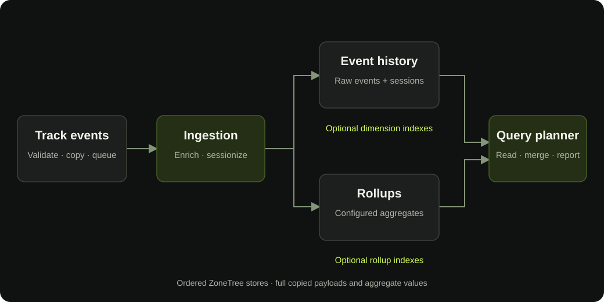

# Engine architecture

ZoneTree.Analytics combines event collection, persistent storage, and reporting inside your application. You own the engine's lifecycle and the dataset it opens.

<figure class="docs-diagram"><figcaption>One event model supports both website reports and custom analytics.</figcaption></figure>

## Collection

Applications submit events directly from .NET, through HTML tracking middleware, or through browser beacons. Events are validated and copied before entering the background pipeline.

Event filters decide what to collect. Enrichment supplies page, source, device, and optional geography context. Custom enrichers adapt that context to your application's vocabulary.

## Ingestion

Background workers process events and maintain session context. Events belonging to the same visitor are routed together so their order is preserved.

Tracking and reporting can continue together. Routine queries read the available dataset without an explicit flush.

## Storage

| Store | Responsibility |
| --- | --- |
| Event history | Detailed events for ad-hoc and behavioral analysis |
| Sessions | Active visit state and session attribution |
| Rollups | Aggregates for recurring dimension combinations |
| Optional indexes | Ordered copies for selected filtered read paths |
| Metadata | Configuration, identity secrets, and historical coverage |

[ZoneTree](https://zonetree.dev/), an ordered storage engine for .NET, provides persistent stores and write-ahead logging. ZoneTree.Analytics builds the event model, aggregation, and reporting on that foundation and coordinates the stores as a dataset.

## Reporting

Typed web reports provide common website metrics. General queries select custom metrics and dimensions. Segments and funnels use event history to analyze behavior.

The planner chooses eligible aggregates, indexes, and event scans. A report can combine sources across a range; its plan explains what contributed and whether coverage has limitations.

## From the engine to the interface

**PureStack** generates the dashboard's static pages and supplies shared UI components. **Regor** connects those pages to reactive report data, filters, and charts.

The analytics engine can also serve other reporting interfaces. PureStack and Regor power the included dashboard; they are not dependencies of the core .NET library.

See the [technology stack](../technology-stack/technology-stack.mdx) for the library and dashboard dependencies.

## Ownership

One engine owns one directory until it closes. Multiple sites can share an engine, while separate datasets require separate directories.

Keep the engine open while the application runs and close it cleanly at shutdown. Store data on persistent storage when it must survive deployment or restarts.

Read [rollup planning](../../performance/rollups/rollups.mdx) for query execution decisions and [deployment](../../operations/deployment/deployment.mdx) for host lifecycle.

## Related pages

- [Event and report model](../data-model/data-model.mdx)
- [Rollups and query planning](../../performance/rollups/rollups.mdx)
- [Deployment and lifecycle](../../operations/deployment/deployment.mdx)

