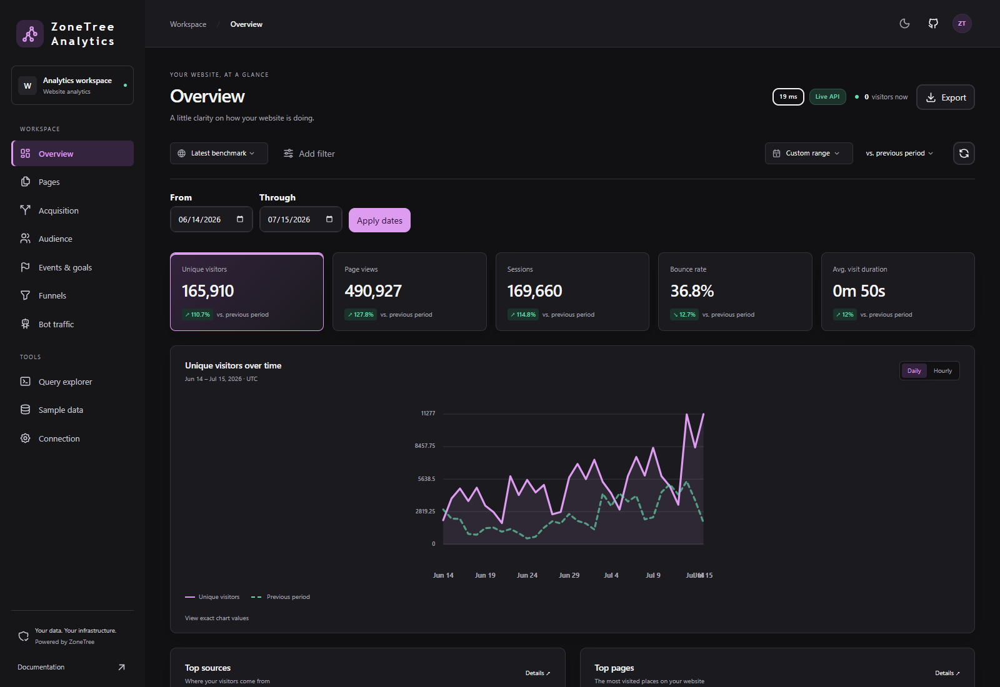
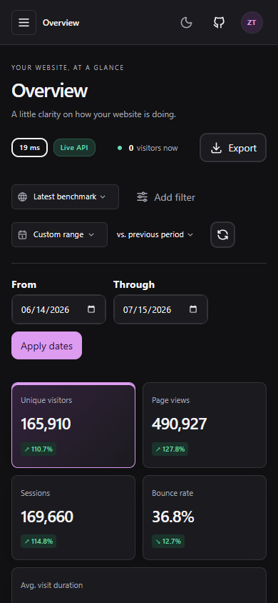

# Dashboard application

Use the dashboard to explore website traffic, acquisition, audience, events, and conversion funnels. It combines the library's reporting API with a ready-to-use interface.

<figure><figcaption>Traffic and engagement for the selected site, date range, and comparison period.</figcaption></figure>

## 1. Run the dashboard

Install UI dependencies from the repository root:

```bash
yarn install
```

Then run the server from the repository root:

```bash
dotnet run --project apps/ZoneTree.Analytics.Dashboard/server
```

Open **http://127.0.0.1:5088/**. The development profile starts the UI watcher automatically, so page and style changes update in the browser.

## 2. Set up the server

The first visit opens the setup wizard. When startup output settles, the server's console ends with a setup link that carries a one-time **setup key**. Open the link, or type the key into the wizard; it proves you control the server, changes on every start, and stops working once setup is complete.

The wizard creates the administrator account, then asks for your sites and their domains, the reporting time zone, and a collection preset: **Privacy first**, **Standard**, or **Full detail**. Every other option has a default; open **Advanced settings** on the last step to change any of them. The time zone, data directory, write-ahead-log directory, and visitor sketch precision are stored with the data and cannot change after setup.

The last step shows the tracking snippet. Add it to every page of your sites; the server assigns each page view to the site whose domain matches the page.

## 3. Explore your data

| Page | Question |
| --- | --- |
| Overview | How are traffic and engagement changing? |
| Pages | Which content attracts visitors? |
| Acquisition | Which sources and campaigns bring traffic? |
| Audience | Where do visitors come from, and how do they browse? |
| Events and goals | Which actions and conversions happen? |
| Funnels | Where do visitors stop before completing a goal? |
| Bot traffic | Which automated clients visit? |
| Query explorer | What does a custom report reveal? |

Choose a site and date range, then add filters or comparisons to explore a specific audience. Export reports when you need to work with the results elsewhere.

## 4. Invite people and manage the server

The administrator manages everything under **Administration** in the sidebar:

| Page | Purpose |
| --- | --- |
| Server status | Engine state, background index work, and storage partitions |
| Sites | Websites, their domains, and the tracking snippet |
| Users | Accounts, roles, site access, and signed-in browsers |
| Indexes & rollups | Pre-aggregated reports and secondary indexes |
| Settings | Collection, privacy, retention, sessions, ingestion, queries, storage, and sign-in security |
| Audit log | Sign-ins, setting changes, and user management |

The dashboard has one administrator. Other users are **analysts**, who read reports and run ad-hoc queries, or **viewers**, who read reports. Each sees all sites or only the sites assigned to them.

Saving settings shows the changes and when each applies: at once, after the engine reopens for a few seconds, or after a server restart. Changes that delete data, such as a shorter retention, need an extra confirmation. Index changes are built from retained data in the background.

## 5. Try sample datasets

In Development mode, the administrator can open **Tools → Sample data** to generate reporting data or run an ingestion benchmark.

| Dataset | Purpose |
| --- | --- |
| Your sites | Traffic collected by the running application |
| Performance samples | Generated traffic for exploring report behavior |
| Latest benchmark | The retained dataset from a successful ingestion benchmark |

Sample tools operate on their own datasets. They do not replace your primary traffic. The latest successful benchmark remains available after restarting the host.

<figure><figcaption>The same reports are available on narrow screens.</figcaption></figure>

## Interface technology

**PureStack** generates the dashboard's pages and provides shared layouts, themes, and UI components. **Regor** powers reports, filters, and charts, with an independent application on each page. See the [technology stack](../../concepts/technology-stack/technology-stack.mdx) for how the interface connects to the .NET engine.

## Deploy the dashboard

Generate the static UI:

```bash
yarn workspace zonetree-analytics-dashboard publish
```

The server serves the published output from `ui/dist/publish`. Use `Dashboard:Watch=false` for static serving in Development, or `Dashboard:Path` for another output directory.

The application listens on all network interfaces by default. Every report, page, and setting requires signing in; only the tracker script and beacon endpoint are public. Serve the dashboard over HTTPS so session cookies are sent only on secure connections. Behind a reverse proxy, the server trusts forwarded headers from loopback proxies; list other proxy addresses in `Dashboard:KnownProxies`.

Users, sessions, settings, and the audit log live in one ZoneTree under `data/system`; set `Dashboard:SystemDirectory` to store them elsewhere. After setup, the stored settings configure the analytics engine. `DashboardAnalyticsOptions.cs` configures only the Development sample and benchmark engines. See [configuration](../../operations/configuration/configuration.mdx) before changing an existing dataset.

## Related pages

- [Deployment and lifecycle](../../operations/deployment/deployment.mdx)
- [Benchmarking](../../performance/benchmarking/benchmarking.mdx)
- [Web reports](../../guides/web-reports/web-reports.mdx)

